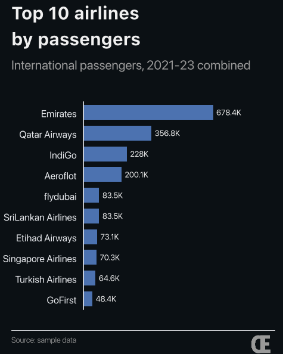
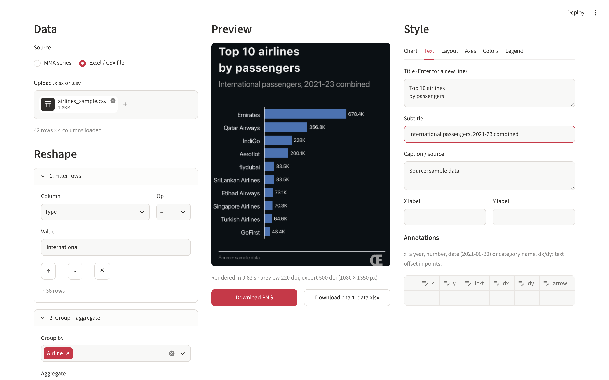
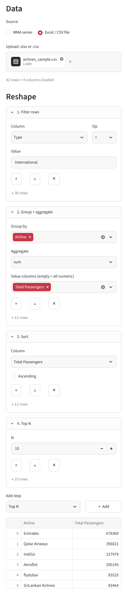
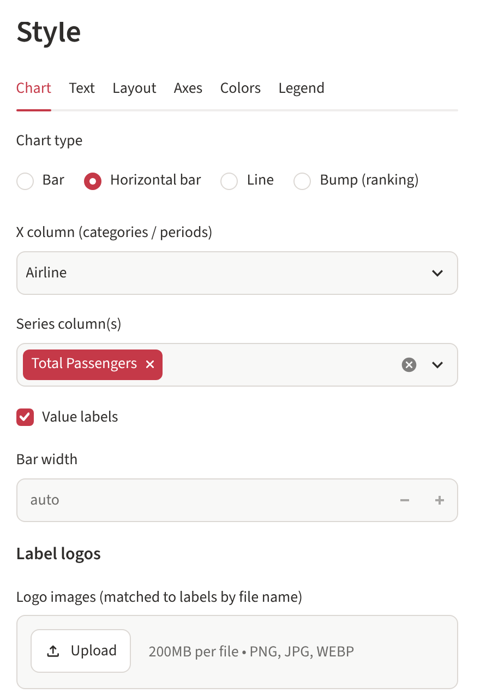

# 1. Getting started

By the end of this guide you'll have built this chart without writing any code:



## Step 1: Install

You need **Python 3.12 or newer**. To check which version you have, run:

```bash
python3 --version
```

Then, from the `elegant_chart` folder, install the library together with the app:

```bash
pip install -e ".[app]"
```

You only need to do this once. When you get new code from GitHub later, run
the command again in case anything new needs installing.

## Step 2: Open Chart Studio

```bash
elegant-chart-studio
```

Your web browser opens a page at `http://localhost:8501`. The app runs on your
own computer, so nothing is uploaded anywhere.

To close the app, go back to the terminal and press `Ctrl + C`.

> **Browser didn't open?** Copy the `Local URL` that the terminal prints and
> paste it into your browser.

## Step 3: Learn the screen



The screen has three panels:

| Panel | What it's for |
|---|---|
| **Data** (left) | Load your data, then tidy it with **reshape steps**. A table at the bottom shows the result. |
| **Preview** (centre) | The chart, redrawn about half a second after every change. **What you see is exactly what you download.** |
| **Style** (right) | Six tabs for everything else: **Chart** (type and columns), **Text**, **Layout**, **Axes**, **Colors**, **Legend**. |

## Step 4: Load the data

1. Under **Source**, choose **Excel / CSV file**.
2. Drag `examples/data/airlines_sample.csv` into the upload box.

The panel shows **42 rows × 4 columns loaded**. Each row is one airline in one
year, so Emirates appears three times: 2021, 2022 and 2023.

> **Using MMA data instead?** Choose **MMA series**, type the series number and
> click **Fetch**. The app uses the same token as your Python scripts (the
> `MMA_API_TOKEN` setting or a `TOKEN.txt` file), and it never shows the token.

## Step 5: Shape the data with steps

We want one bar per airline: its total international passengers, biggest
first, top 10 only. That takes four steps. For each one, pick it in
**Add step**, click **＋ Add**, then fill it in:

| # | Step | Fill in | What it does |
|---|---|---|---|
| 1 | **Filter rows** | Column `Type`, Op `=`, Value `International` | Keeps only international flights |
| 2 | **Group + aggregate** | Group by `Airline`, Aggregate `sum`, Value columns `Total Passengers` | Adds the three years together, giving one row per airline |
| 3 | **Sort** | Column `Total Passengers`, leave **Ascending** unticked | Puts the biggest airline first |
| 4 | **Top N** | N `10` | Keeps the first 10 rows |



Under each step, a small note such as **→ 12 rows** tells you how many rows
are left after it. The table at the bottom shows the final result.

> **Tip:** In step 2, always choose **Value columns**. If you leave it empty,
> the app adds up *every* number column, including `Year`, which gives you
> nonsense values like 6066.

## Step 6: Choose the chart

Open the **Chart** tab on the right.

1. **Chart type**: choose **Horizontal bar**. Long airline names are easier to read on the side.
2. **X column**: `Airline` (this is the category for each bar; the app usually picks it for you).
3. **Series column(s)**: `Total Passengers`.
4. Tick **Value labels** to print each number at the end of its bar.



## Step 7: Add words

Open the **Text** tab:

- **Title**: `Top 10 airlines` then press **Enter** and type `by passengers`.
  Short two-line titles look best.
- **Subtitle**: `International passengers, 2021-23 combined`. Use the subtitle
  to say what is being measured.
- **Caption / source**: `Source: sample data`

## Step 8: Download

Click **Download PNG** to get the finished 1080 × 1350 image, and
**Download chart_data.xlsx** to get the numbers behind the chart.

You've made your first chart. 🎉

## Good to know

- **Switching chart type keeps everything.** Try **Bar** or **Line** in the
  Chart tab: your data, steps, title and colours all stay.
- **Nothing is saved when you close the app.** Download what you need before
  you close it.
- **If something goes wrong, the app tells you.** A red message appears on the
  step or setting that needs fixing. The app keeps working.

**Next:** [2. Chart recipes →](02-chart-recipes.md)
