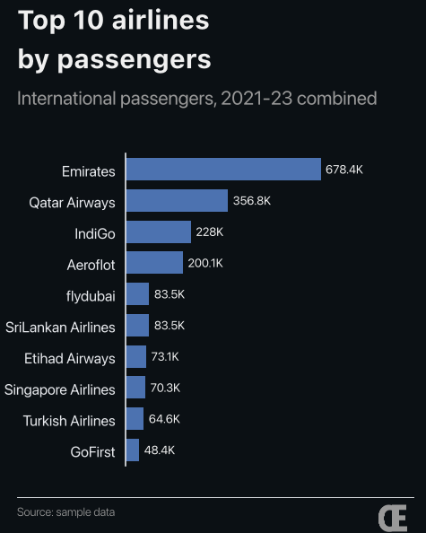
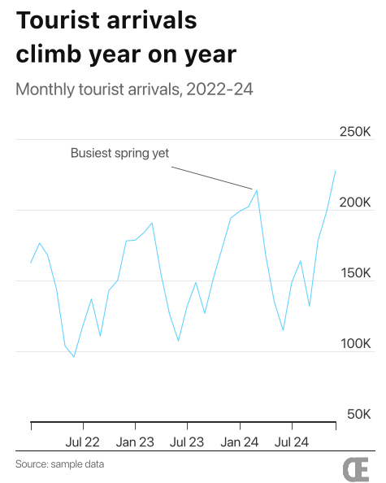
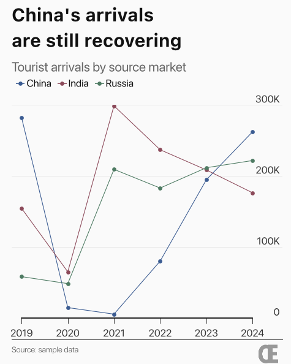
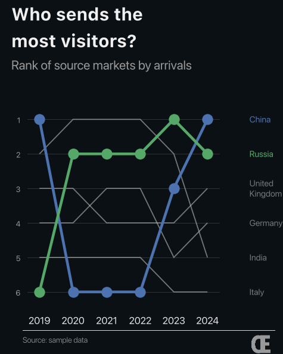
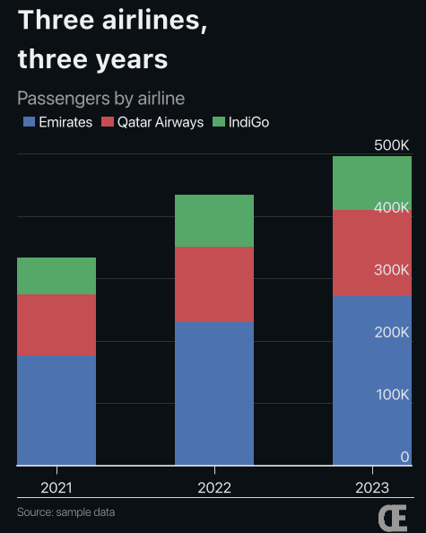

# 2. Chart recipes

Five step-by-step recipes, one for each kind of chart. Every recipe starts the
same way: open Chart Studio, choose **Excel / CSV file**, and upload the sample
file it names (from `examples/data/`).

New to the app? Do [1. Getting started](01-getting-started.md) first.

**Which chart should I use?**

| You want to show… | Use |
|---|---|
| Who is biggest, as a ranked list | [Horizontal bar](#recipe-1-top-10-ranking-horizontal-bar) |
| How one number changes over time | [Line](#recipe-2-a-trend-over-time-line) |
| How a few groups change over time | [Several lines](#recipe-3-compare-a-few-groups-several-lines) |
| How positions in a ranking change | [Bump](#recipe-4-rankings-over-time-bump) |
| How a total splits into parts | [Stacked bar](#recipe-5-parts-of-a-total-stacked-bar) |

---

## Recipe 1: Top 10 ranking (horizontal bar)

**File:** `airlines_sample.csv`

This chart is built step by step in [Getting started](01-getting-started.md),
so this is the short version.

**Steps**
1. Filter rows: `Type` `=` `International`
2. Group and total up: by `Airline`, `sum`, value column `Total Passengers`
3. Sort: `Total Passengers`, Ascending unticked
4. Keep the top rows: How many rows to keep `10`

**Chart tab:** Horizontal bar · X column `Airline` · Series `Total Passengers` · ✅ Value labels

**Text tab:** Title `Top 10 airlines⏎by passengers` (⏎ means press **Enter**)

**Add airline logos (optional):** in the Chart tab, under **Label logos**,
upload image files named after the airlines, such as `Emirates.png` or
`Qatar Airways.png`. Each logo is matched to the bar with the same name, and
the table lets you fix any that didn't match.

 

---

## Recipe 2: A trend over time (line)

**File:** `tourist_arrivals_sample.csv`. It has one row per month, so no
steps are needed.

**Chart tab:** Line · X column `Month` · Series `Arrivals`

**Colors tab:** Theme `consulting_light` gives a white background.

**Axes tab:** Date style → Custom, code `%b %y` (needs a date column). This labels the axis *Jul 22, Jan 23, …*.
For years only, use `%Y`, or set **Label every… years (line)** to `1`.

**Text tab:**
- Title `Tourist arrivals⏎climb year on year`
- Subtitle `Monthly tourist arrivals, 2022-24`
- **Annotations**: add one row to point at a spot on the line.

  | x | y | text | dx | dy | arrow |
  |---|---|---|---|---|---|
  | 2024-03-01 | 213842 | Busiest spring yet | -75 | 12 | ✅ |

  `x` and `y` are the point on the line. `dx` and `dy` move the text away
  from that point, measured in points (negative `dx` means left). Tick
  **arrow** to draw a line from the text to the point.

> **Why do the dates work?** The app recognises text like `2024-03-01` in a
> CSV file as a date. Excel date cells work too.

 

---

## Recipe 3: Compare a few groups (several lines)

**File:** `arrivals_by_market_sample.csv`

The file is **long**: one row per country per year. To draw one line per
country, each country needs its own column. That's what the **Pivot** step
does.

**Steps**
1. Filter rows: `Market` `in` `China, India, Russia` (with `in`, separate the values with commas)
2. Pivot (long → wide): Rows (become the x-axis) `Year` · Columns (one series each) `Market` · Numbers to plot `Arrivals`

After the pivot, the table has the columns `Year`, `China`, `India` and
`Russia`.

**Chart tab:** Line · X column `Year` · Series: all three countries · ✅ Markers

**Axes tab:** X tick step `1` puts a label on every year.

**Colors tab:** Theme `newsroom_muted`

The legend appears on its own because there is more than one line. To change
how many legend items sit side by side, use the **Legend** tab.

 

---

## Recipe 4: Rankings over time (bump)

**File:** `arrivals_by_market_sample.csv`

A bump chart shows **who is 1st, 2nd, 3rd…** in each year, rather than the
values themselves.

**Steps**
1. Pivot (long → wide): Rows (become the x-axis) `Year` · Columns (one series each) `Market` · Numbers to plot `Arrivals`

**Chart tab**
- Chart type: **Bump (ranking)** · X column `Year` · Series: all six countries
- **Highlight**: `China`, `Russia`. These get bold colour; the rest become
  thin grey lines. If you leave it empty, every line is coloured.
- **Label text**: in the `United Kingdom` row, type `United\nKingdom` so the
  long name wraps onto two lines (`\n` means "new line").
- *Optional:* change **Other lines colour / opacity** and the line widths.
- Tick **Smallest value = rank 1** only for "lower is better" data, such as prices.

 

---

## Recipe 5: Parts of a total (stacked bar)

**File:** `airlines_sample.csv`

**Steps**
1. Filter rows: `Airline` `in` `Emirates, Qatar Airways, IndiGo`
2. Pivot (long → wide): Rows (become the x-axis) `Year` · Columns (one series each) `Airline` · Numbers to plot `Total Passengers`

**Chart tab:** Bar · X column `Year` · Series: the three airlines · ✅ **Stacked**

Untick **Stacked** to put the bars side by side instead.

**Colors tab:** to give one airline a fixed colour, change its row from
`auto` to a role (`primary`, `secondary`, …) or to **custom**, then pick a
colour.

 

---

**Next:** [3. Tweaks and fixes →](03-tweaks-and-fixes.md)
