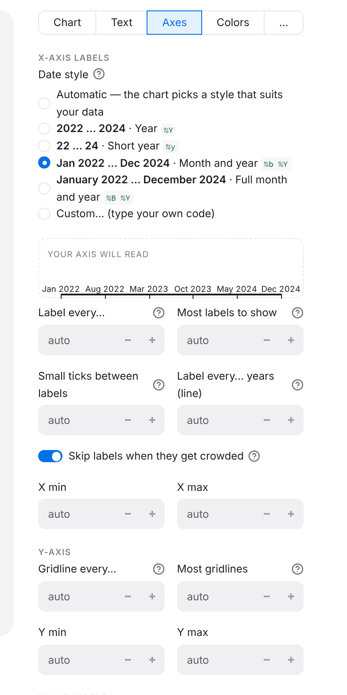

# 3. Tweaks and fixes

Use this page to look things up when you need them. Every setting updates the
preview straight away, so the quickest way to learn a setting is to change it
and watch the chart.

## "I want to…"

| I want to… | Where | What to do |
|---|---|---|
| Break the title onto two lines | Text | Press **Enter** inside **Title** |
| Thin out crowded x-axis labels | Axes | Set **Most labels to show**, for example `5`, or set **Label every…** |
| Label every year | Axes | **Label every…** `1` |
| Show months as *Jan 24* | Axes | **Date style** → Custom, code `%b %y`. This needs a date column. The list shows what each style prints before you pick it |
| Show months as *J F M A…* | Axes | **Date style** `Month initial`, or `First month in full, then initials` for *Jan F M A…*. Initials are narrow, so every month gets a label (up to 13) |
| Give the first label the year, e.g. *Jan 2026 Feb Mar…* | Axes | **Date style** → Custom, code `%b %Y\|%b`. The part before `\|` is used for the first label only |
| Show years only on a monthly chart | Axes | **Date style** `Year` together with **Label every… years (line)** `1` |
| Add a small tick between labels | Axes | **Small ticks between labels** `1` (for example, mid-year) |
| Write `'21` instead of `2021` | Chart | Tick **Compact years** |
| Tilt long x labels | Chart | **X label rotation**, for example `45` |
| Cut or wrap long category names | … (Layout) | **Wrap labels after (characters)** plus **When a label is too long**: wrap or cut short |
| Show values as `12%` | Axes | **Number style** → Percent. The data must be fractions, so 0.12 shows as 12% |
| Show values as `1,234.5` | Axes | **Number style** → Custom, with `{x:,.1f}`. A line below shows the result, or says what's wrong |
| Start the y-axis at zero, or fix its range | Axes | **Y min** and **Y max**. Fill in both, or neither |
| Print numbers on the bars or points | Chart | Tick **Value labels** |
| Hide the y-axis numbers and gridlines | … (Layout) | Turn off **Show gridlines and y numbers**. This works well together with value labels |
| Put y labels on the left | … (Layout) | **Y-axis side** `left` |
| Change all colours at once | Colors | Click a **Theme** card. Each card is a small version of your own chart |
| Give one series a fixed colour | Colors | Change that series from *Automatic* to a colour. The swatches show the theme's five colours |
| Make one series fainter | Colors | Lower its **Opacity** |
| Change the legend layout | … | **Legend columns** |
| Remove or replace the footer logo | … (Layout) | **Footer logo**: `Off`, or `Custom` and upload an image |
| Remove the whole footer | … (Layout) | Turn off **Footer (line, source caption, logo)** |
| Add space after the last data point | … (Layout) | **Extra room on the right**, for example `0.05` for 5% of the data range |

Any number box that shows **auto** works out a good value on its own. To go
back to automatic, clear the box.

The **Axes** section lists each date style with what it prints for your dates,
and a small preview axis shows the labels your chart will get.

**Why is there no Date style?** A date style only applies to a real date column.
If your x values are names, or whole numbers such as the year `2024`, they print
as they are, so the app doesn't offer one. To format dates, use a column of
dates (write them as `2024-03-01` in a CSV file).

## Data steps

Click **＋ Add step** in the Data panel. The menu groups the steps into Rows,
Dates, Numbers and Shape. Steps run from top to bottom, and each one shows how
many rows are left after it.

| I want to… | Step | What to do |
|---|---|---|
| Keep the 10 biggest (or smallest) | **Keep the top or bottom rows** | **Top** or **Bottom**, how many, and **Ranked by** a number column. With *Current row order* it keeps the first (or last) rows |
| Show only 2020 to 2024 | **Keep some years or months** | Drag the **Years** slider. It works on dates and on year numbers such as `2021` |
| Keep one value per year, e.g. December | **Keep some years or months** | Pick **Dec** under **Months**. No month picked means every month |
| Put every date on the last day of its month | **Move dates to month start or end** | **End of month**. Each choice shows what your first date becomes |
| Turn monthly data into yearly | **Roll up by month, quarter or year** | **One row per** `Year`, then **Add up** for flows (sales, arrivals) or **Last value** for levels (reserves, prices). Rows are dated at the end of each period |
| Show values in thousands or millions | **Show in thousands, millions…** | Pick the unit. Each choice shows what your first value becomes. Then say the unit in the subtitle |
| Show growth | **Change over time (%, index)** | **% change from a year earlier** (it works out 12 rows for monthly data, 4 for quarterly), **% change from the row before**, **Change from the row before**, or **Index (first row = 100)** |
| Smooth a jumpy line | **Moving average** | **Average over this many rows**, e.g. `12` on monthly data |
| Give a series a nicer legend name | **Rename a column** | Pick the column and type the new name |

Steps that change numbers (thousands, change, moving average) change every
number column if you leave **Columns to change** empty. Year numbers such as
`2021` are never changed.

## Themes

| Theme | Background | Good for |
|---|---|---|
| `newsroom_dark` | Near-black | Social media, the default look |
| `consulting_dark` | Dark navy | Presentations with dark slides |
| `newsroom_muted` | Off-white | Reports, multi-colour comparisons |
| `consulting_light` | White | Documents, a clean single-colour look |

The first series always gets the theme's **primary** colour, the second gets
**secondary**, and so on.

## Problems and fixes

| What you see | Why | Fix |
|---|---|---|
| A red message on a reshape step | That step can't run. Usually a column it uses has disappeared, for example after a Group or Pivot. | Read the message. A column marked **⚠ (missing)** needs a new choice. The steps after it are skipped until you fix it. |
| Strange totals such as `6066` for Year | A **Group** step added up the `Year` column too | In that step, choose **Columns to combine** explicitly |
| Bars or lines stacked on top of each other, wrong-looking chart | There are still several rows per x value | Add a **Group and total up** step, or a **Pivot** for one column per group |
| Dates show as plain text labels | The column isn't stored as a date | In CSV files, write dates as `2024-03-01`. In Excel, format the cells as dates. |
| "Series column(s) must be numeric" | A number column contains text, such as `n/a` or `1,234` | Clean the file, or filter those rows out |
| "There is no data to plot" | A filter removed every row | Check the filter's spelling and capital letters. `=` must match exactly. |
| The legend is missing | There's only one series. This is on purpose: the subtitle names it. | Add more series, or describe the one series in the subtitle |
| Long names are cut off | The label is too long for the space | Shorten it with **Wrap labels after (characters)**, or on bump charts use **Label text** with `\n` |
| MMA **Fetch** fails | The token is missing, or the series number is wrong | Set `MMA_API_TOKEN` or put the token in `TOKEN.txt`, then check the series number |
| The app is slow | The data is very large | Filter or group it early, near the top of the steps |

**Next:** [4. Charts in Python →](04-charts-in-python.md)
