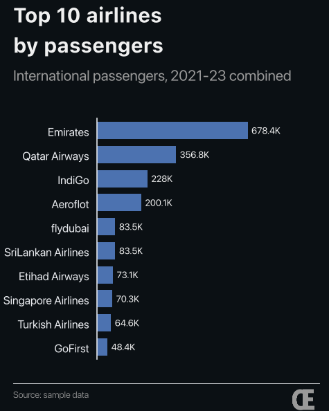
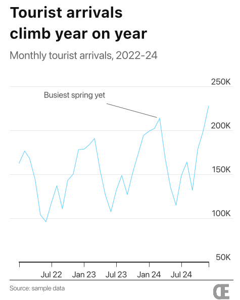
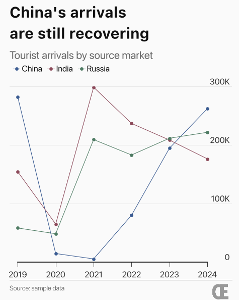
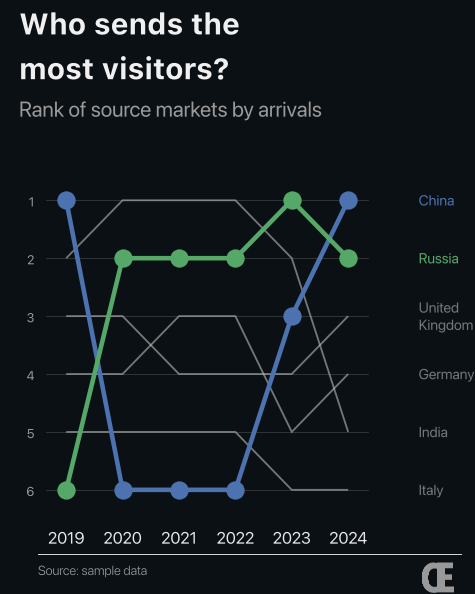
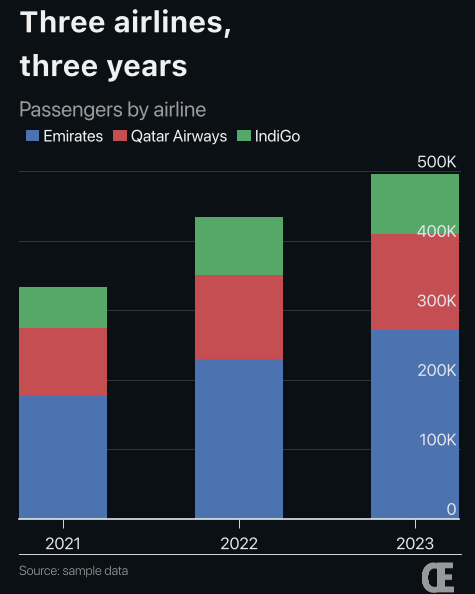

# Elegant Chart guides

These guides show you how to make charts with Elegant Chart. Most of them use
**Chart Studio**, the point-and-click app, so you don't need to write any code.

| Guide | What you'll learn | Time |
|---|---|---|
| [1. Getting started](01-getting-started.md) | Install the app, open it, and make your first chart | 10 min |
| [2. Chart recipes](02-chart-recipes.md) | Step-by-step builds for five common charts | 5 min each |
| [3. Tweaks and fixes](03-tweaks-and-fixes.md) | Fix crowded labels, change colours, and solve common problems | Look things up as needed |
| [4. Charts in Python](04-charts-in-python.md) | Make the same charts from a Python script | 10 min |

## Sample data

Every guide uses three small sample files in [`examples/data/`](../../examples/data/).
The numbers are **made up for practice**. They are not official statistics.

| File | What's in it | Shape |
|---|---|---|
| `airlines_sample.csv` | Passengers per airline per year, marked International or Domestic | Long: one row per airline per year |
| `tourist_arrivals_sample.csv` | Tourist arrivals per month, 2022–2024 | One row per month |
| `arrivals_by_market_sample.csv` | Tourist arrivals per source country per year, 2019–2024 | Long: one row per country per year |

## What you can make

| | | |
|:-:|:-:|:-:|
|  |  |  |
| Horizontal bar ([recipe](02-chart-recipes.md#recipe-1-top-10-ranking-horizontal-bar)) | Line over time ([recipe](02-chart-recipes.md#recipe-2-a-trend-over-time-line)) | Comparing groups ([recipe](02-chart-recipes.md#recipe-3-compare-a-few-groups-several-lines)) |
|  |  | |
| Rankings over time ([recipe](02-chart-recipes.md#recipe-4-rankings-over-time-bump)) | Parts of a total ([recipe](02-chart-recipes.md#recipe-5-parts-of-a-total-stacked-bar)) | |

Every chart is exported at **1080 × 1350 px** (a 4:5 portrait shape that works
well on phones and social media).
